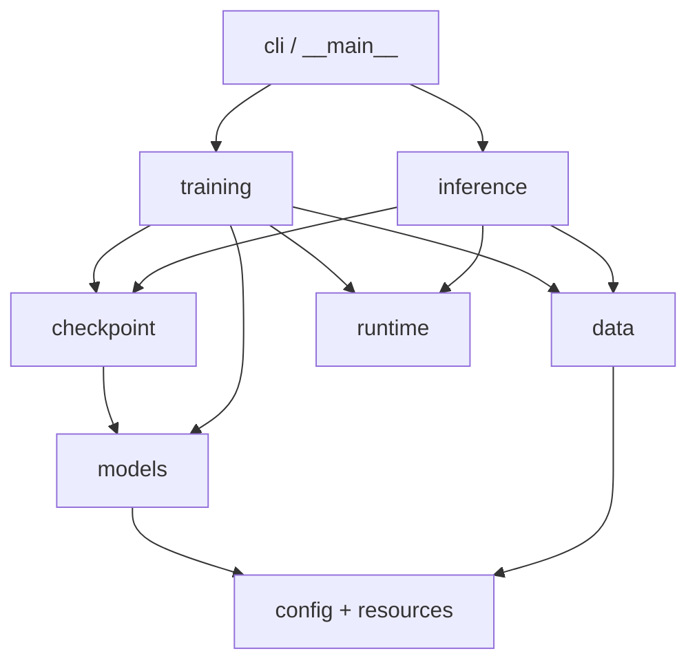

# 工程架构

`0.2.0` 将网络实现、运行流程和命令行分开。项目采用 `src` 布局，包的公开接口是
`m4_loop`；目录中的 Python 文件先安装再使用，不依赖当前工作目录或临时修改搜索路径。

## 模块职责

| 模块 | 职责 | 不承担的职责 |
| --- | --- | --- |
| `models/forecaster.py` | 组织输入 Tensor、RevIN、Patch、循环编码器和预测头 | 文件读取、设备策略、优化器、CLI |
| `models/layers.py` | RevIN、共享循环层、预测头等小型网络组件 | 训练流程、Parquet、checkpoint |
| `models/losses.py` | 固定容量校验与有效标签点损失 | 数据划分、容量估计、权重选点 |
| `models/outputs.py` | 统一 Tensor 输出类型 | 持久化和后处理 |
| `data/windows.py` | 校验 Parquet 窗口、缺失标签过滤、Dataset 和 collate | 网络前向、训练循环 |
| `training/trainer.py` | 优化器、训练循环、早停和最佳权重保存 | 参数解析和推理导出 |
| `training/evaluation.py` | 按有效标签点聚合验证指标 | 训练更新、CLI |
| `inference/predictor.py` | 加载权重、批量预测、导出 Parquet | 优化器和训练入口 |
| `cli/` | 参数解析、子命令调度、命令行结果展示 | 网络和损失实现 |
| `config.py` | 默认配置读取、覆盖合并、严格校验 | 模型参数注册 |
| `checkpoint.py` | 原子保存、格式校验、严格权重加载 | 训练循环 |
| `runtime.py` | 设备解析、随机种子和批数据转移 | 命令行参数解析 |

`layers.py` 中的三个组件规模较小，保留在一个模块中；独立职责通过类区分。
不额外引入注册器、通用 Pipeline 或抽象 Trainer 层。

## 依赖方向



推理流程不导入训练流程；网络层不导入数据层、运行流程或 CLI。
CLI 的参数帮助可以在不加载模型和训练代码的情况下展示。
集成测试通过拦截不允许的模块导入验证这些边界。

## 入口与公共 API

唯一的参数解析实现放在 `cli/`。console scripts 和 Python 模块入口复用这套实现：

| 用途 | 标准入口 | 兼容入口 |
| --- | --- | --- |
| 训练 | `m4-loop train` / `python -m m4_loop train` | `m4-loop-train` / `python -m m4_loop.train` |
| 预测 | `m4-loop predict` / `python -m m4_loop predict` | `m4-loop-predict` / `python -m m4_loop.predict` |

Python 侧推荐：

```python
from m4_loop import M4LoopModel, load_config
from m4_loop.checkpoint import load_checkpoint
from m4_loop.training import train, evaluate
from m4_loop.inference import predict
```

包根目录的 `train.py`、`predict.py`、`model.py` 只保留迁移兼容功能，没有第二份业务实现。
内部代码使用规范模块路径，不反向依赖兼容入口。
未使用的 `transformer_models.py` 旧框架别名已移除，层模块路径为 `m4_loop.models.layers`。

## 配置与资源

`src/m4_loop/resources/default.yaml` 是默认配置的唯一来源，通过
`importlib.resources` 加载并随 wheel 发布。`configs/` 只存实验或演示覆盖项：

- `untied_4.yaml`：四层不共享对照。
- `shared_1x4.yaml`：单层循环四次。
- `smoke.yaml`：配合人工数据的小窗口检查。

运行产物写入调用方指定的输出目录，不写入源码或安装目录。
模型输入字段、窗口尺寸、随机种子和设备配置的语义与 `0.1.0` 相同。

## 权重兼容与测试

本次没有更改网络属性名、`state_dict` 键、Tensor 运算、默认配置或损失公式；
checkpoint 的 `format_version` 和 `architecture_version` 保持 `1`。
模块迁移不会影响此格式，因为 checkpoint 保存配置和参数字典，不序列化 Python 模型对象。

`tests/unit/` 验证模型与数值契约；`tests/integration/` 验证训练、导出、安装资源、
命令行和模块依赖。主测试环境不插入工作区源码路径；发布验收使用普通 wheel 安装，
从仓库之外运行统一命令。临时复制包的独立性测试另行禁止导入原 M4 和公共框架。

另以重构前保存的 v1 checkpoint 和固定输入检查重构前后的预测、embedding、损失及
梯度，具体结果记在 [验证记录](validation.md)。
